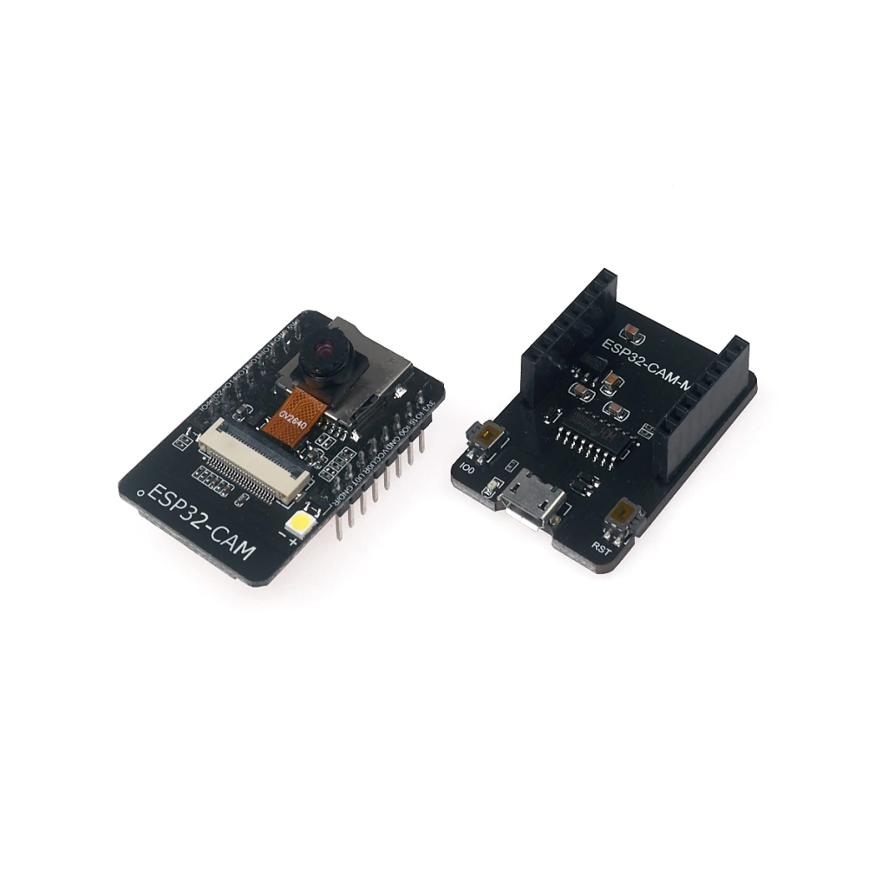
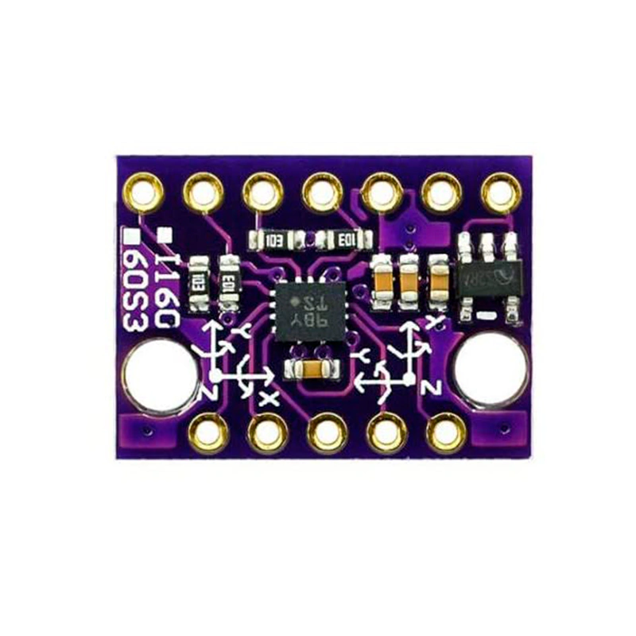
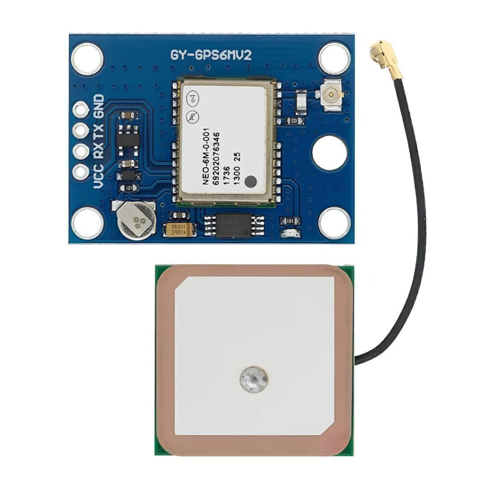

# Sistema CleanTECH.

El sistema cleanTECH . Es un sistema automata programado con capacidades de inteligencia artificial que le permite hacer una deteccion de diversos datos de adquisicion de las variables del entorno principales enfocadas a la cuestion de reconocimiento de entidades estaticas o en movimiento.

## Nota importante:
Dentro del desglose de los parametros tomados en cuenta en el desarrrollo del sistema cleanTECH se desglosara en esta sección del repositorio de gitHUB los parametros que albergan la ejecución del codigo dentro del sistema CleanTECH

## Componentes utilizados dentro de la construcción del sistema cleanTECH:

- ### Motorreductor JGA25-370 12VDC 330RPM Con Encoder Integrado:

El **JGA25-370** es un motorreductor de corriente continua (12V) que incluye un **encoder incremental** para medir con precisión la velocidad y la posición del giro. Sus engranajes metálicos lo hacen resistente y duradero, y su encoder permite conectarlo a microcontroladores como Arduino, ESP32, PIC o Raspberry Pi para sistemas de control realimentado (PID). Es ideal para robótica, automatización y proyectos educativos avanzados.

## Características principales
- **Modelo:** JGA25-370 DC + Encoder.
- **Voltaje nominal:** 12 VDC.
- **Rango de velocidad (sin carga):** 60 – 350 RPM (según la relación de engranajes).
- **Torque máximo:** 2.5 – 5 kg-cm (según modelo y carga).
- **Corriente:** 80 – 200 mA sin carga; hasta 1.5 A en carga máxima.
- **Relación de reducción:** 1:30 a 1:300.
- **Engranajes:** Metálicos de alta precisión.
- **Eje de salida:** 4 mm tipo D (longitud 10–12 mm).
- **Dimensiones:** Longitud total 70–85 mm (con encoder), peso 90–110 g.
- **Encoder:** Incremental de 2 canales (A y B), resolución de 11–13 pulsos por vuelta del motor (multiplicable por la reducción).
- **Alimentación del encoder:** 3.3 – 5 VDC (compatible con microcontroladores).
- **Ruido:** Bajo a moderado.

## Funcionamiento del encoder
El encoder genera dos señales digitales (A y B) desfasadas 90°. Esto permite medir tanto la **velocidad** como la **dirección** de giro. Se conecta directamente a pines digitales del microcontrolador, usando interrupciones para el canal A y una entrada auxiliar para el B. Alimentación: VCC (5V) y GND.

## Curvas de rendimiento típicas (a 12V)
| Relación | Velocidad sin carga (RPM) | Corriente sin carga (mA) | Torque máx. (kg-cm) |
|----------|---------------------------|--------------------------|----------------------|
| 1:30     | 350                       | 180                      | 2.5                  |
| 1:50     | 200                       | 160                      | 3.2                  |
| 1:100    | 120                       | 130                      | 4.0                  |
| 1:210    | 60                        | 110                      | 5.0                  |

## Aplicaciones comunes
- Robots móviles y seguidores de línea.
- Sistemas de control de posición y velocidad.
- Cámaras motorizadas y mecanismos de dirección.
- Impresoras 3D, CNC miniatura y automatización ligera.
- Vehículos autónomos y proyectos educativos de robótica.

## Ventajas
- Encoder integrado para control preciso.
- Engranes metálicos resistentes.
- Funcionamiento silencioso y estable.
- Amplio rango de velocidad y torque.
- Bajo consumo energético.

## Recomendaciones de uso
- No exceder los 12V DC.
- Verificar polaridad antes de conectar.
- Fijar el motor correctamente para evitar vibraciones.
- Usar drivers compatibles (L298N, TB6612FNG, L9110).
- Filtrar las señales del encoder si hay ruido eléctrico.

## Observaciones finales
El JGA25-370 es una solución confiable para proyectos que requieren precisión y durabilidad. Su encoder permite una retroalimentación efectiva para sistemas PID y control digital, siendo ideal para aplicaciones educativas, de automatización o experimentales.

- ### XL4015 Convertidor DC-DC Buck Reductor (5A):

El **XL4015** es un módulo integrado (chip) que funciona como un **convertidor reductor de voltaje DC a DC (Buck Converter)**. Su función principal es tomar una corriente continua de mayor voltaje (por ejemplo, de una batería de 12V o 24V) y convertirla de manera muy eficiente en un voltaje menor y estable (como 5V) para alimentar dispositivos electrónicos.

## Características principales
- **Entrada de voltaje:** Acepta desde **8V hasta 36V**.
- **Salida ajustable:** Puede entregar desde **1.25V hasta 32V**.
- **Corriente máxima:** Soporta hasta **5 Amperios** de salida constante.
- **Alta eficiencia:** Alcanza hasta un **96%**, lo que significa que pierde muy poca energía en forma de calor.
- **Frecuencia de trabajo:** Opera a 180 kHz (fija).
- **Encapsulado:** Viene en un paquete compacto TO263-5L, diseñado para disipar bien el calor.

## ¿Cómo funciona?
El chip utiliza un sistema de modulación por ancho de pulso (PWM) que enciende y apaga un interruptor interno muy rápido. Al combinarse con componentes externos (como un inductor y capacitores), "suaviza" la energía para entregar un voltaje de salida estable. 
El voltaje de salida se ajusta fácilmente usando dos resistencias externas (un divisor de voltaje) conectadas al pin de retroalimentación (FB); el chip siempre intentará mantener ese pin a 1.25V exactos.

## Distribución de Pines
El XL4015 tiene 5 pines clave:
1. **GND:** Tierra (conexión negativa).
2. **FB:** Retroalimentación (sirve para ajustar el voltaje de salida con resistencias).
3. **SW:** Salida del interruptor de potencia (se conecta al inductor).
4. **VC:** Regulador interno (suele llevar un capacitor a la entrada).
5. **VIN:** Entrada de voltaje (de 8V a 36V).

## Sistemas de Protección Integrados
Para evitar que el chip o tus dispositivos se dañen, el XL4015 incluye de fábrica:
- **Límite de corriente:** Corta o limita la energía si se superan los 5A.
- **Protección contra cortocircuitos:** Si hay un corto en la salida, reduce su frecuencia de trabajo para protegerse.
- **Apagado térmico:** Si el chip se calienta demasiado, se apaga automáticamente para no quemarse.

## Aplicaciones Comunes
- Alimentación de monitores LCD y televisores.
- Instrumentos portátiles y equipos de medición.
- Equipos de telecomunicaciones y redes.
- Cualquier proyecto de electrónica o robótica que necesite bajar el voltaje de una batería de forma eficiente sin generar mucho calor (a diferencia de los reguladores lineales tradicionales).

### ESP32-S3-DevKitC-1:

## 1. Distribución y "Multiplexación" de Pines (Páginas 1 y 2)
El chip tiene **56 pines** distribuidos en un encapsulado cuadrado. Algo muy importante es que el ESP32-S3 usa **"multiplexación"**. 
* **¿Qué significa esto?** Que un solo pin físico puede hacer varias funciones diferentes (como enviar datos, leer un sensor, o encender un LED) dependiendo de cómo lo programes por software. Esto permite que el chip sea pequeño sin perder capacidades.

## 2. Tipos de Funciones de los Pines (Páginas 6 a 10)
Los pines se dividen en tres grupos principales:
* **Pines IO (Entrada/Salida):** Son los pines estándar para conectar componentes (botones, pantallas, relés, etc.). Tienen funciones predefinidas para comunicaciones como UART (puerto serie), SPI (para tarjetas SD y pantallas) y JTAG (para depuración).
* **Funciones RTC (Real-Time Clock):** Algunos pines siguen funcionando incluso cuando el chip está en modo de "sueño profundo" (Deep-sleep) consumiendo muy poca energía. Son ideales para despertar el chip con un sensor de movimiento o un botón.
* **Funciones Analógicas:** Ciertos pines pueden leer voltajes variables (Convertidor Analógico-Digital o ADC) o detectar toques capacitivos (Touch Sensor).

## 3. Advertencias Importantes: ¡Cuidado con estos pines! (Páginas 4, 5 y 11)
El documento advierte sobre varios detalles críticos que pueden arruinar tu proyecto si no los tienes en cuenta:
* **Pines de Memoria (Flash/PSRAM):** Los pines del 26 al 32 (aproximadamente) están conectados a la memoria interna del chip. **NUNCA** los uses para conectar otras cosas, o el chip se colgará y no arrancará.
* **Pines de Configuración (Strapping Pins):** Pines como GPIO0, GPIO3, GPIO45 y GPIO46 deciden cómo arranca el chip (por ejemplo, si entra en modo de programación o modo normal). Deben estar en niveles de voltaje específicos al encender.
* **"Glitches" al Encender:** Algunos pines (como GPIO19 y GPIO20) emiten pequeños pulsos eléctricos (picos) de unos 60 microsegundos justo cuando se enciende el chip. Si tienes conectado un relé o un motor, podría activarse brevemente por error.
* **Pines de USB y UART0:** Normalmente están reservados para programar el chip y ver los mensajes en la computadora.

## 4. Alimentación y Encendido (Páginas 15 y 16)
* **Voltajes:** El chip no usa un solo voltaje. Tiene reguladores internos que convierten la energía para diferentes partes: 1.1V para el procesador digital, 1.1V para el reloj de tiempo real (RTC) y 1.8V para la memoria flash.
* **El botón de encendido (CHIP_PU):** El pin **CHIP_PU** es el encargado de encender o resetear el chip. Para que funcione, debe recibir un voltaje alto (High). El datasheet muestra un gráfico de tiempo: hay que esperar al menos **50 microsegundos** después de que llegue la energía para activar este pin, de lo contrario el chip podría no arrancar correctamente.

- ### ESP32-CAM con Cámara OV2640:

::include{file=/Markdowns/Esp-cam.md}
- ### BMI160 Sensor Giroscopio y Acelerómetro De 6DOF.

## ¿Qué es el BMI160?
Es una **unidad de medición inercial (IMU) muy pequeña y de bajo consumo**. Combina en un solo chip:
- Un **acelerómetro** (mide aceleración y orientación).
- Un **giroscopio** (mide velocidad angular o rotación).

Ambos sensores tienen resolución digital de **16 bits**. Su tamaño es de solo **2.5 × 3.0 × 0.8 mm**, en un encapsulado LGA de 14 pines, ideal para dispositivos móviles y wearables.

## ¿Para qué se usa?
Aplicaciones típicas:
- Realidad aumentada y juegos inmersivos.
- Navegación indoor y mapas 3D.
- Podómetros y conteo de pasos.
- Fusión de sensores de 6 y 9 ejes.
- Ratones aéreos, controladores de juego y drones.
- Estabilización óptica de imagen en cámaras.

## Características principales
- **Bajo consumo:** en modo completo (giroscopio + acelerómetro) consume típicamente **950 µA**.
- **Modos de ahorro:** modo suspendido de **3 µA**, detección de movimiento y podómetro con menos de **200 µA**.
- **Alimentación flexible:**
  - VDD: **1.71 V a 3.6 V**.
  - VDDIO: **1.2 V a 3.6 V**.
- **Rangos configurables:**
  - Acelerómetro: **±2g, ±4g, ±8g, ±16g**.
  - Giroscopio: **±125°/s hasta ±2000°/s**.
- **Interfaz principal:** I2C o SPI.
- **Interfaz secundaria:** permite conectar sensores externos, como un magnetómetro (búsqueda de dirección).
- **FIFO integrado de 1024 bytes:** guarda datos temporalmente para reducir consumo y evitar pérdidas.
- **Interrupciones por hardware:** detección de movimiento, doble toque, orientación, caída libre, impacto, etc.
- **Compatible con Android 4.4 y Windows 8.1**.

## Distribución de pines (Página 2)
El documento incluye un diagrama de los 14 pines visto desde abajo. Los pines incluyen:
- Alimentación: VDD, VDDIO, GND, GNDIO.
- Comunicación: SDA/SDI, SCL/SCK, CSB, SDO.
- Interrupciones: INT1 e INT2.
- Interfaz para magnetómetro externo: ASDx y ASCx.
- Interfaz SPI secundaria para estabilización óptica.

- ### Módulo GPS GY-NEO6MV2.
 {width=50%}
## 1. ¿Qué es y cómo funciona el módulo? (Página 1)
* **Precisión:** Tiene una precisión horizontal de **2.5 metros** y una tasa de actualización de 1 vez por segundo (1Hz).
* **Indicador LED:** 
  * **Sin parpadeo:** Está buscando satélites.
  * **Parpadeo cada 1 segundo:** Ha encontrado señal (Position Fix).
* **Consejo importante:** Debe usarse **al aire libre**; no funciona bien en interiores.
* **Alimentación:** Aunque opera a 3.3V, se recomienda conectarlo primero a **5V durante 1 o 2 horas** para cargar su batería interna antes de usarlo.

## 2. Conexión y Materiales Necesarios (Páginas 1 y 2)
Para el proyecto necesitas:
* Un **Arduino UNO**.
* El módulo **GY-NEO6MV2**.
* Un **Shield (placa de expansión)** para Arduino que incluya lector de tarjeta **SD** y un **Reloj en Tiempo Real (RTC)**.
* **Conexiones:** El pin TX del GPS va al pin 4 del Arduino, el RX al pin 3, VCC a 5V y GND a GND.

## 3. El Código y las Librerías (Páginas 2 y 3)
El documento incluye un programa (sketch) en C++ que requiere las librerías `TinyGPS` (para interpretar los datos del GPS) y `RTClib` (para la hora exacta).

**¿Qué hace el código?**
1. Inicializa la tarjeta SD y el reloj de tiempo real.
2. Revisa si el GPS tiene señal.
3. Extrae las coordenadas de **Latitud** y **Longitud**.
4. Muestra las coordenadas en el Monitor Serie de Arduino.
5. **Guarda los datos:** Escribe las coordenadas y la hora exacta en un archivo de texto llamado `gpsLOG.txt` dentro de la tarjeta SD.

## 4. Resultados y Uso en el Mundo Real (Página 4)
* **El archivo final:** Muestra una captura de pantalla del archivo `gpsLOG.txt` abierto en un ordenador, con columnas de fecha, latitud, longitud y hora.
* **Uso autónomo:** La última imagen muestra el proyecto montado sobre una batería de 6V, demostrando que se puede llevar el Arduino, el GPS y la batería en una mochila o vehículo para registrar rutas sin necesidad de un ordenador.
* **Paciencia:** Al encenderlo, hay que esperar entre **40 y 120 segundos** (al aire libre) para que la luz del GPS empiece a parpadear y comience a registrar datos.
