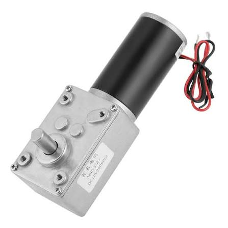
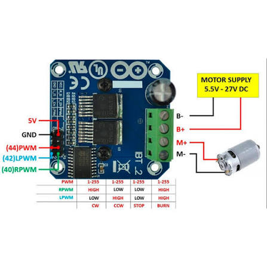
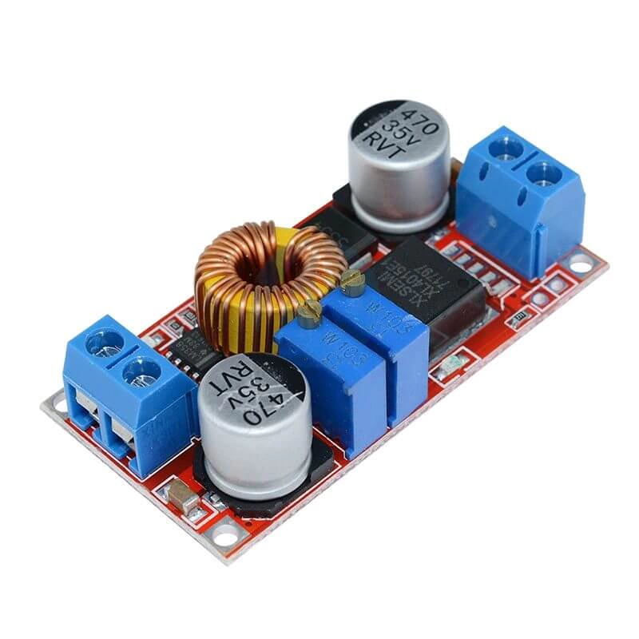
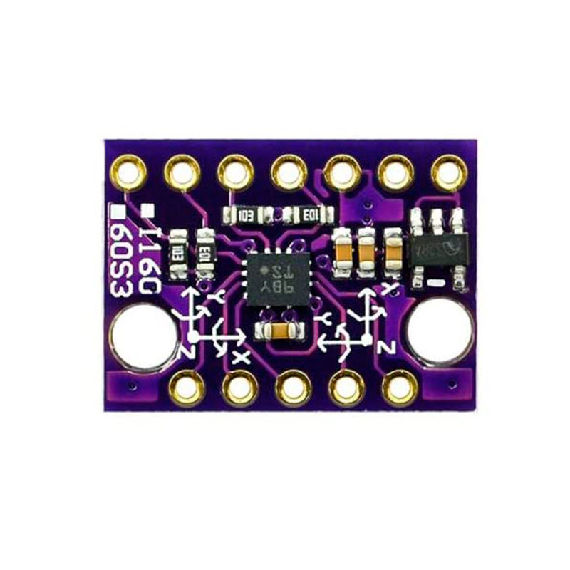

# Sistema CleanTECH.

El sistema cleanTECH . Es un sistema automata programado con capacidades de inteligencia artificial que le permite hacer una deteccion de diversos datos de adquisicion de las variables del entorno principales enfocadas a la cuestion de reconocimiento de entidades estaticas o en movimiento.

## Nota importante:
Dentro del desglose de los parametros tomados en cuenta en el desarrrollo del sistema cleanTECH se desglosara en esta sección del repositorio de gitHUB los parametros que albergan la ejecución del codigo dentro del sistema CleanTECH

## Componentes utilizados dentro de la construcción del sistema cleanTECH:

## Actuadores del sistema:

- # Motorreductor JGA25-370 12VDC 330RPM Con Encoder Integrado:

El **JGA25-370** es un motorreductor de corriente continua (12V) que incluye un **encoder incremental** para medir con precisión la velocidad y la posición del giro. Sus engranajes metálicos lo hacen resistente y duradero, y su encoder permite conectarlo a microcontroladores como Arduino, ESP32, PIC o Raspberry Pi para sistemas de control realimentado (PID). Es ideal para robótica, automatización y proyectos educativos avanzados.

## Características principales
- **Modelo:** JGA25-370 DC + Encoder.
- **Voltaje nominal:** 12 VDC.
- **Rango de velocidad (sin carga):** 60 – 350 RPM (según la relación de engranajes).
- **Torque máximo:** 2.5 – 5 kg-cm (según modelo y carga).
- **Corriente:** 80 – 200 mA sin carga; hasta 1.5 A en carga máxima.
- **Relación de reducción:** 1:30 a 1:300.
- **Engranajes:** Metálicos de alta precisión.
- **Eje de salida:** 4 mm tipo D (longitud 10–12 mm).
- **Dimensiones:** Longitud total 70–85 mm (con encoder), peso 90–110 g.
- **Encoder:** Incremental de 2 canales (A y B), resolución de 11–13 pulsos por vuelta del motor (multiplicable por la reducción).
- **Alimentación del encoder:** 3.3 – 5 VDC (compatible con microcontroladores).
- **Ruido:** Bajo a moderado.

## Funcionamiento del encoder
El encoder genera dos señales digitales (A y B) desfasadas 90°. Esto permite medir tanto la **velocidad** como la **dirección** de giro. Se conecta directamente a pines digitales del microcontrolador, usando interrupciones para el canal A y una entrada auxiliar para el B. Alimentación: VCC (5V) y GND.

## Curvas de rendimiento típicas (a 12V)
| Relación | Velocidad sin carga (RPM) | Corriente sin carga (mA) | Torque máx. (kg-cm) |
|----------|---------------------------|--------------------------|----------------------|
| 1:30     | 350                       | 180                      | 2.5                  |
| 1:50     | 200                       | 160                      | 3.2                  |
| 1:100    | 120                       | 130                      | 4.0                  |
| 1:210    | 60                        | 110                      | 5.0                  |

## Aplicaciones comunes
- Robots móviles y seguidores de línea.
- Sistemas de control de posición y velocidad.
- Cámaras motorizadas y mecanismos de dirección.
- Impresoras 3D, CNC miniatura y automatización ligera.
- Vehículos autónomos y proyectos educativos de robótica.

## Ventajas
- Encoder integrado para control preciso.
- Engranes metálicos resistentes.
- Funcionamiento silencioso y estable.
- Amplio rango de velocidad y torque.
- Bajo consumo energético.

## Recomendaciones de uso
- No exceder los 12V DC.
- Verificar polaridad antes de conectar.
- Fijar el motor correctamente para evitar vibraciones.
- Usar drivers compatibles (L298N, TB6612FNG, L9110).
- Filtrar las señales del encoder si hay ruido eléctrico.

## Observaciones finales
El JGA25-370 es una solución confiable para proyectos que requieren precisión y durabilidad. Su encoder permite una retroalimentación efectiva para sistemas PID y control digital, siendo ideal para aplicaciones educativas, de automatización o experimentales.

- # Motor Reductor DC 12V 200RPM 5840-31ZY (Engranaje Helicoidal / Gusano)

El **5840-31ZY** es un motorreductor de corriente continua de 12 V con caja de engranajes tipo helicoidal (tornillo sinfín / worm gear). Destaca por su diseño compacto de eje de salida perpendicular al motor, alto par y función **autoblocante**: cuando se corta la alimentación, el eje de salida permanece fijo y no retrocede por la carga. Es una opción robusta y silenciosa para automatización, mecanismos de posicionamiento y proyectos que requieren fuerza en poco espacio.

## Características principales
- **Modelo:** 5840-31ZY (versión 12 V / ≈200 RPM)
- **Voltaje nominal:** 12 VDC (rango típico de trabajo 6-18 V)
- **Velocidad sin carga:** ≈260 RPM  
- **Velocidad nominal (con carga):** ≈200 RPM  
- **Torque nominal:** ≈5 kg·cm  
- **Torque máximo (bloqueo):** ≈25 kg·cm  
- **Corriente sin carga:** ≤ 0,3 A  
- **Corriente nominal:** ≤ 1,6 A  
- **Corriente de bloqueo:** ≈ 6,5 A  
- **Potencia nominal:** ≈ 20-21 W  
- **Relación de reducción típica:** 31:1 (para la versión de 200 RPM)
- **Tipo de engranaje:** Helicoidal / tornillo sinfín metálico (alta resistencia y autobloqueo)
- **Eje de salida:** 8 mm tipo D (puede ser simple o doble según variante)
- **Dimensiones aproximadas:** Cuerpo compacto (alrededor de 58 × 40 × 115 mm según configuración)
- **Peso:** ≈ 350-365 g
- **Sentido de giro:** Reversible (CW/CCW) invirtiendo la polaridad
- **Ruido:** Bajo a moderado

## Funcionamiento del engranaje helicoidal
El sistema de tornillo sinfín transmite el movimiento de forma perpendicular y genera un alto par de reducción. Su característica más útil es el **autobloqueo**: sin corriente el eje no se mueve aunque haya carga, lo que evita la necesidad de frenos adicionales en muchas aplicaciones. Se controla fácilmente con drivers de potencia (L298N, BTS7960, TB6612, etc.) y es compatible con Arduino, ESP32 u otros microcontroladores.

## Curvas de rendimiento típicas (a 12 V – referencia serie 5840-31ZY)

| Relación | Velocidad sin carga (RPM) | Velocidad nominal (RPM) | Torque nominal (kg·cm) | Torque de bloqueo (kg·cm) |
|----------|---------------------------|--------------------------|------------------------|---------------------------|
| 17:1     | 470                       | 380                      | 2,7                    | 13,5                      |
| **31:1** | **260**                   | **200**                  | **5**                  | **25**                    |
| 49:1     | 160                       | 130                      | 8                      | 40                        |
| 100:1    | 80                        | 60                       | 16                     | 70                        |

## Aplicaciones comunes
- Cortinas y persianas motorizadas
- Mecanismos de apertura y cierre (puertas, trampillas, cajones)
- Brazos robóticos y posicionadores
- Automatización de vending, dispensadores y equipos de oficina
- Sistemas de elevación ligera y plataformas
- Proyectos de robótica y automatización doméstica/industrial ligera

## Ventajas
- Alto par en un formato muy compacto gracias al engranaje de tornillo sinfín
- Función autoblocante (no necesita freno adicional en muchas aplicaciones)
- Construcción metálica resistente
- Bajo nivel de ruido y funcionamiento estable
- Fácil control de sentido y velocidad
- Buena relación calidad-precio para proyectos de medio-alto torque

## Recomendaciones de uso
- No superar los 12-14 V de forma continua.
- Usar un driver con capacidad suficiente (mínimo 2-3 A continuos y picos de 6-7 A).
- Verificar la polaridad antes de conectar (rojo/negro según sentido deseado).
- Fijar firmemente el motor para evitar vibraciones.
- En aplicaciones de carga elevada o continua, considerar ventilación o ciclos de trabajo.
- Evitar el bloqueo prolongado para no dañar el motor o la caja de engranajes.

## Observaciones finales
El **Motor Reductor DC 12V 200RPM 5840-31ZY** es una solución muy práctica cuando se necesita un buen par, autobloqueo y un diseño compacto de eje a 90°. Ideal para automatización, mecanismos de movimiento y proyectos de robótica que requieren fiabilidad y fuerza en espacios reducidos.

# Componentes de potencia:

Los componentes de potencia forman una familia de dispositivos y módulos diseñados para gestionar, convertir y controlar energía eléctrica en aplicaciones donde circulan tensiones, corrientes y potencias relativamente elevadas. Su función principal no es procesar información, sino actuar como intermediarios eficientes entre una fuente de energía y una carga.

En términos generales, estos componentes permiten regular el flujo de energía, adaptar niveles eléctricos, mejorar la calidad de la alimentación y facilitar el funcionamiento seguro de sistemas eléctricos y electrónicos. Su desempeño se evalúa considerando aspectos como la eficiencia, las pérdidas, la capacidad de disipar calor, la robustez, la fiabilidad y la integración con otros elementos del sistema.

Su uso es común en sectores como la industria, el transporte, la generación y distribución de energía, los sistemas de alimentación y muchas aplicaciones de automatización. Más que un único tipo de dispositivo, los componentes de potencia representan un conjunto amplio de soluciones tecnológicas cuyo diseño y selección dependen de las condiciones eléctricas, térmicas y ambientales de cada aplicación.

- # Puente-H BTS7960 IBT_2:

El **BTS 7960** es un módulo de potencia diseñado para el control de motores de corriente continua (DC) que requieren mucha energía. Integra en un solo encapsulado un interruptor de alta potencia superior (MOSFET de canal P), un interruptor inferior (MOSFET de canal N) y su propio circuito de control (driver). Es ideal para construir puentes H o sistemas de control de motores en robótica y automoción.

## Características principales
- **Alta corriente:** Soporta picos de hasta **43 A** y una corriente continua de 40 A.
- **Baja resistencia:** Tiene una resistencia de paso muy baja (típicamente 16 mΩ), lo que significa que pierde muy poca energía en forma de calor.
- **Control directo:** Se conecta fácilmente a microcontroladores (Arduino, ESP32, PIC, etc.) gracias a sus entradas de nivel lógico.
- **PWM Integrado:** Permite controlar la velocidad del motor mediante modulación por ancho de pulso (PWM) de hasta **25 kHz**.
- **Diagnóstico de corriente:** Incluye un pin de salida (IS) que informa al microcontrolador sobre la cantidad de corriente que está pasando por el motor y detecta fallos.
- **Protecciones integradas:** Evita daños por sobretemperatura, sobretensión, subtensión, sobrecorriente y cortocircuitos.
- **Reducción de ruido:** Al usar un MOSFET de canal P, no necesita una "bomba de carga" externa, lo que reduce las interferencias electromagnéticas (EMI). Además, permite ajustar la velocidad de conmutación (slew rate) con una resistencia externa.

## Distribución de Pines (Encapsulado de 7 u 8 pines)
El chip se conecta a la placa de la siguiente manera:
- **VS:** Alimentación de potencia (generalmente de 8V a 18V, con un máximo de 27.5V).
- **OUT:** Salida de potencia hacia el motor.
- **IN:** Entrada de control (decide si se activa el interruptor superior o el inferior).
- **INH:** Inhibidor (si se pone en bajo, el chip entra en modo de reposo y apaga ambas salidas).
- **SR:** Ajuste de la velocidad de conmutación (se conecta a tierra mediante una resistencia).
- **IS:** Salida de corriente y diagnóstico de errores (se conecta a una resistencia para medir el voltaje).
- **GND:** Tierra.

## ¿Cómo funciona internamente?
El BTS 7960 está diseñado para trabajar en configuraciones de medio puente. Para controlar un motor en ambos sentidos (adelante y atrás), normalmente se usan **dos** de estos chips juntos para formar un **Puente H**. 
El chip genera un "tiempo muerto" automático para asegurarse de que el interruptor superior y el inferior nunca se enciendan al mismo tiempo (lo cual causaría un cortocircuito). Si detecta un fallo, como una sobrecorriente, reduce la energía mediante un modo de conmutación rápida en lugar de calentarse peligrosamente.

## Aplicaciones comunes
- Control de motores de corriente continua en robótica.
- Sistemas de dirección y tracción en vehículos (automoción).
- Control de motores en impresoras 3D o máquinas CNC.
- Construcción de puentes H para inversión de giro.

- # XL4015 Convertidor DC-DC Buck Reductor (5A):

El **XL4015** es un módulo integrado (chip) que funciona como un **convertidor reductor de voltaje DC a DC (Buck Converter)**. Su función principal es tomar una corriente continua de mayor voltaje (por ejemplo, de una batería de 12V o 24V) y convertirla de manera muy eficiente en un voltaje menor y estable (como 5V) para alimentar dispositivos electrónicos.

## Características principales
- **Entrada de voltaje:** Acepta desde **8V hasta 36V**.
- **Salida ajustable:** Puede entregar desde **1.25V hasta 32V**.
- **Corriente máxima:** Soporta hasta **5 Amperios** de salida constante.
- **Alta eficiencia:** Alcanza hasta un **96%**, lo que significa que pierde muy poca energía en forma de calor.
- **Frecuencia de trabajo:** Opera a 180 kHz (fija).
- **Encapsulado:** Viene en un paquete compacto TO263-5L, diseñado para disipar bien el calor.

## ¿Cómo funciona?
El chip utiliza un sistema de modulación por ancho de pulso (PWM) que enciende y apaga un interruptor interno muy rápido. Al combinarse con componentes externos (como un inductor y capacitores), "suaviza" la energía para entregar un voltaje de salida estable. 
El voltaje de salida se ajusta fácilmente usando dos resistencias externas (un divisor de voltaje) conectadas al pin de retroalimentación (FB); el chip siempre intentará mantener ese pin a 1.25V exactos.

## Distribución de Pines
El XL4015 tiene 5 pines clave:
1. **GND:** Tierra (conexión negativa).
2. **FB:** Retroalimentación (sirve para ajustar el voltaje de salida con resistencias).
3. **SW:** Salida del interruptor de potencia (se conecta al inductor).
4. **VC:** Regulador interno (suele llevar un capacitor a la entrada).
5. **VIN:** Entrada de voltaje (de 8V a 36V).

## Sistemas de Protección Integrados
Para evitar que el chip o tus dispositivos se dañen, el XL4015 incluye de fábrica:
- **Límite de corriente:** Corta o limita la energía si se superan los 5A.
- **Protección contra cortocircuitos:** Si hay un corto en la salida, reduce su frecuencia de trabajo para protegerse.
- **Apagado térmico:** Si el chip se calienta demasiado, se apaga automáticamente para no quemarse.

## Aplicaciones Comunes
- Alimentación de monitores LCD y televisores.
- Instrumentos portátiles y equipos de medición.
- Equipos de telecomunicaciones y redes.
- Cualquier proyecto de electrónica o robótica que necesite bajar el voltaje de una batería de forma eficiente sin generar mucho calor (a diferencia de los reguladores lineales tradicionales).

# Microontroladores.

- # ESP32-S3-DevKitC-1:

## 1. Distribución y "Multiplexación" de Pines.
El chip tiene **56 pines** distribuidos en un encapsulado cuadrado. Algo muy importante es que el ESP32-S3 usa **"multiplexación"**. 
* **¿Qué significa esto?** Que un solo pin físico puede hacer varias funciones diferentes (como enviar datos, leer un sensor, o encender un LED) dependiendo de cómo lo programes por software. Esto permite que el chip sea pequeño sin perder capacidades.

## 2. Tipos de Funciones de los Pines.
Los pines se dividen en tres grupos principales:
* **Pines IO (Entrada/Salida):** Son los pines estándar para conectar componentes (botones, pantallas, relés, etc.). Tienen funciones predefinidas para comunicaciones como UART (puerto serie), SPI (para tarjetas SD y pantallas) y JTAG (para depuración).
* **Funciones RTC (Real-Time Clock):** Algunos pines siguen funcionando incluso cuando el chip está en modo de "sueño profundo" (Deep-sleep) consumiendo muy poca energía. Son ideales para despertar el chip con un sensor de movimiento o un botón.
* **Funciones Analógicas:** Ciertos pines pueden leer voltajes variables (Convertidor Analógico-Digital o ADC) o detectar toques capacitivos (Touch Sensor).

## 3. Advertencias Importantes: ¡Cuidado con estos pines!
El documento advierte sobre varios detalles críticos que pueden arruinar tu proyecto si no los tienes en cuenta:
* **Pines de Memoria (Flash/PSRAM):** Los pines del 26 al 32 (aproximadamente) están conectados a la memoria interna del chip. **NUNCA** los uses para conectar otras cosas, o el chip se colgará y no arrancará.
* **Pines de Configuración (Strapping Pins):** Pines como GPIO0, GPIO3, GPIO45 y GPIO46 deciden cómo arranca el chip (por ejemplo, si entra en modo de programación o modo normal). Deben estar en niveles de voltaje específicos al encender.
* **"Glitches" al Encender:** Algunos pines (como GPIO19 y GPIO20) emiten pequeños pulsos eléctricos (picos) de unos 60 microsegundos justo cuando se enciende el chip. Si tienes conectado un relé o un motor, podría activarse brevemente por error.
* **Pines de USB y UART0:** Normalmente están reservados para programar el chip y ver los mensajes en la computadora.

## 4. Alimentación y Encendido.
* **Voltajes:** El chip no usa un solo voltaje. Tiene reguladores internos que convierten la energía para diferentes partes: 1.1V para el procesador digital, 1.1V para el reloj de tiempo real (RTC) y 1.8V para la memoria flash.
* **El botón de encendido (CHIP_PU):** El pin **CHIP_PU** es el encargado de encender o resetear el chip. Para que funcione, debe recibir un voltaje alto (High). El datasheet muestra un gráfico de tiempo: hay que esperar al menos **50 microsegundos** después de que llegue la energía para activar este pin, de lo contrario el chip podría no arrancar correctamente.

# Componentes Sensoriales.

Los componentes sensoriales son dispositivos fundamentales en la tecnología moderna. Su función principal consiste en detectar y medir magnitudes físicas o químicas del entorno —como temperatura, presión, movimiento, luz o presencia de sustancias— y convertir esa información en señales que pueden ser interpretadas por sistemas electrónicos o digitales.

Actúan como el “punto de contacto” entre el mundo físico y los sistemas de control, monitoreo o automatización. Gracias a ellos es posible recopilar datos del entorno de forma continua y precisa, lo que permite tomar decisiones, activar procesos o generar alertas de manera automática.

En la actualidad, los sensores están presentes en prácticamente todos los ámbitos: desde la industria y la medicina hasta los dispositivos de uso cotidiano. Su capacidad para transformar fenómenos del mundo real en información útil los convierte en una pieza clave de la digitalización y de la Internet de las Cosas.

-	# Encoder (GM 25-370) para JGA25-370:

- # BMI160 Sensor Giroscopio y Acelerómetro De 6DOF.

## ¿Qué es el BMI160?
Es una **unidad de medición inercial (IMU) muy pequeña y de bajo consumo**. Combina en un solo chip:
- Un **acelerómetro** (mide aceleración y orientación).
- Un **giroscopio** (mide velocidad angular o rotación).

Ambos sensores tienen resolución digital de **16 bits**. Su tamaño es de solo **2.5 × 3.0 × 0.8 mm**, en un encapsulado LGA de 14 pines, ideal para dispositivos móviles y wearables.

## ¿Para qué se usa?
Aplicaciones típicas:
- Realidad aumentada y juegos inmersivos.
- Navegación indoor y mapas 3D.
- Podómetros y conteo de pasos.
- Fusión de sensores de 6 y 9 ejes.
- Ratones aéreos, controladores de juego y drones.
- Estabilización óptica de imagen en cámaras.

## Características principales
- **Bajo consumo:** en modo completo (giroscopio + acelerómetro) consume típicamente **950 µA**.
- **Modos de ahorro:** modo suspendido de **3 µA**, detección de movimiento y podómetro con menos de **200 µA**.
- **Alimentación flexible:**
  - VDD: **1.71 V a 3.6 V**.
  - VDDIO: **1.2 V a 3.6 V**.
- **Rangos configurables:**
  - Acelerómetro: **±2g, ±4g, ±8g, ±16g**.
  - Giroscopio: **±125°/s hasta ±2000°/s**.
- **Interfaz principal:** I2C o SPI.
- **Interfaz secundaria:** permite conectar sensores externos, como un magnetómetro (búsqueda de dirección).
- **FIFO integrado de 1024 bytes:** guarda datos temporalmente para reducir consumo y evitar pérdidas.
- **Interrupciones por hardware:** detección de movimiento, doble toque, orientación, caída libre, impacto, etc.
- **Compatible con Android 4.4 y Windows 8.1**.

## Distribución de pines.
El documento incluye un diagrama de los 14 pines visto desde abajo. Los pines incluyen:
- Alimentación: VDD, VDDIO, GND, GNDIO.
- Comunicación: SDA/SDI, SCL/SCK, CSB, SDO.
- Interrupciones: INT1 e INT2.
- Interfaz para magnetómetro externo: ASDx y ASCx.
- Interfaz SPI secundaria para estabilización óptica.

